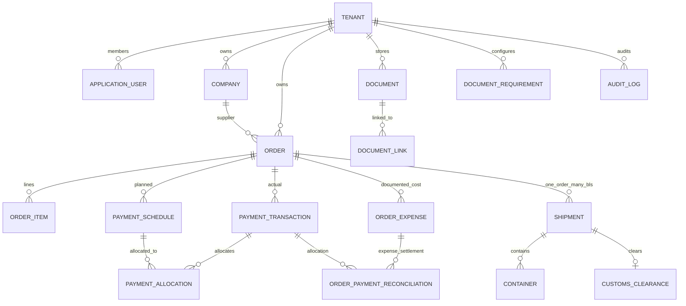

# وثيقة — المخطط المعماري لنظام إدارة استيراد الخيوط (Target + Verified Slices)

**المرحلة:** Target Design, 2026-11-06  
**Authority:** ملف حسام `Wathiqa-MVP-Plan.md` + قرارات L3 المعتمدة في `01-DECISIONS.md`.

## 1. Business Boundary

Wathiqa تدير سجل استيراد التاجر: الجهات التجارية، أوامر الشراء وبنودها، التزامات الدفع والحوالات، بوالص الشحن وحاوياتها، مراحل التخليص والمستندات المرفقة، والفلاتر التي تجيب عن أسئلة الأعمال الخمسة. البرنامج **لا** يحرر العقود بقالب Rich Text في الـ MVP الجديد، ولا يغيّر المستند الرسمي تلقائياً بناء على استخراج PDF. لا OCR، ولا تحويل عملات، ولا Landed Cost، ولا تطبيق جوال.

الجهات الأساسية: Tenant Admin، Tenant Staff، Tenant Staff مع `CanManagePayments`. يوجد مسار تشغيلي مقيّد لإنشاء أول Tenant/Admin، لكن **لا يوجد Public Signup** ولا قدرة افتراضية لمشغّل المنصة على الاطلاع على عقود التجار.

## 2. Deployment — One App / Many Tenants

```text
Browser (Arabic Next.js)  --HTTPS, same-origin--> Reverse Proxy
                                                  |-- / --> Next.js
                                                  |-- /api --> ASP.NET Core API
                                                                  |-- Identity + Cookie/CSRF
                                                                  |-- CurrentTenant + Policies
                                                                  |-- Business services
                                                                  |-- PostgreSQL (shared rows + TenantId)
                                                                  |-- IFileStore -> PRIVATE persistent volume
```

- نشر واحد على VPS. واجهة Next.js وASP.NET Core API ضمن نفس الأصل الفعلي (scheme + host + port). لا يعوّل على CORS لحماية البيانات.
- الـ DB ليس متاحاً عبر الإنترنت. مجلد المستندات خارج `wwwroot` ولا يعرّضه Next.js كملفات عامة.
- الحاويات/الخدمات يجب ألا تفقد الملفات أو مفاتيح Data Protection عند restart/redeploy. Backup مستقل لـ PostgreSQL + volume المستندات + مفتاح التشفير إذا استُعمل.
- `TenantId` من Claims/session بعد تحقق Identity، **ليس** من body أو query string.
- ارتداد التطبيق إلى `.NET 10` قبل تنفيذ الـ MVP مناسب لدعم LTS (تطوير تدريجي/اختبار توافق).

## 3. Boundaries / Modules (modular monolith, one API)

| Capability owner | Owns | Must not own |
|---|---|---|
| Identity & Tenants | `Tenant`, `ApplicationUser`, `Role`, user permissions, invitation, authenticated tenant context | Business Orders أو DB-per-tenant |
| Parties | `Company` + allowed Types | Tenant membership |
| Purchasing | `Order`, `OrderItem`, numbering, commercial totals and administrative lifecycle | Bank transactions or shipment events |
| Payments & Order Reconciliation | `PaymentSchedule`, `PaymentTransaction`, allocations, order-only discrepancies, documented order expenses, corrections, audit | Transferable supplier credit or user-editable PaymentStatus |
| Logistics | `Shipment` (B/L), `Container`, delivery events, ETA and source status | Payment balances |
| Customs | `CustomsClearance` 1:1 Shipment, broker, clearance details, release | Per-container arrival |
| Document Registry | `Document` (file metadata), `DocumentLink`, document requirement/exception rules, private file storage | OCR/AI extraction in MVP |
| Read Models | Filtered Orders/summary/dashboard projections, scoped by tenant | Authoritative business data |

These are *logical* modules within one .NET API and one deployment, not independent services.

## 4. Data Model — proposed MVP

Every tenant-owned business row (except Tenant/Identity-specific exceptions): `Id (Guid)`, `TenantId`, `CreatedAtUtc`, `CreatedById`, `UpdatedAtUtc`, `UpdatedById`, `IsDeleted`, optional `Revision`. Use UTC instants for events and `DateOnly` for contractual due dates, with a per-tenant reporting timezone.



### Parties / Purchasing
- `Company`: NameAr/NameEn, CompanyType, supplier bank details (treat as sensitive), contact and address, all tenant-scoped.
- `Order`: unique Number by Tenant + year, SupplierId, optional CustomerId, date, Incoterm, ports, currency, total, paid, PaymentStatus, ArrivalStatus, ClearanceStatus, administrative Status, ContainerCount and DeliveredCount.
- `OrderItem`: product classification, Denier, Luster, Grade, ColorType, QuantityKg, UnitPrice, PriceUnit, LineTotal, HS Code.
- Money `decimal(18,4)` for unit price/internal values; amounts rounded consistently to currency minor units on the final order line (USD/EUR 2-digit for MVP). `decimal(18,3)` quantity kg. `PriceUnit=TON` -> unit price per 1,000 KG.
- `NumberSequence`: tenant, year, prefix, lastNumber; unique index and transaction-safe increment.

### Payment model (approved split)
- `PaymentSchedule`: OrderId, Kind (Advance/Balance/LC/Other), PlannedAmount, DueDate, Method?, Notes, Status(active/cancelled).
- `PaymentTransaction`: OrderId, Amount (in Order.Currency), PaidDate/OccurredAt, Method, BankName, Reference, ProofDocumentId?, Note, RecordedBy, State(active/voided), correctedFrom?; **there is no actual transfer until a transaction exists**.
- `PaymentAllocation` (proposed engineering mechanism): PaymentTransactionId, PaymentScheduleId, Amount; allows one schedule to be covered by several transfers and one transfer to cover several schedule obligations. All linked rows must share **the same Order and Tenant**. Unallocated transfers can be represented explicitly but are flagged for reconciliation.
- **P-01-R1 (approved; supersedes P-01):** Actual transfers remain in `PaymentTransaction` with original bank evidence. Amount exceeding the commercial order value is an **unresolved discrepancy belonging exclusively to the original Order**. It is NOT supplier credit, transferable balance, or automatic payment toward another order.
- **Example:** Commercial order amount 100,000 USD; recorded remittance 105,000 USD -> `GrossTransferred=105,000`, `AppliedCommercialSettlement=100,000`, `UnresolvedDiscrepancy=5,000`, `RemainingCommercialDue=0`. Display a prominent **"فرق محاسبي غير مسوّى: 5,000 USD"** warning until reconciled. A zero remaining commercial due does not mean the order's books are reconciled.
- `OrderExpense` (proposed): `Id`, `TenantId`, `OrderId`, `Category`, `Description`, `Amount`, `Currency`, `Payee`, `SupportingDocumentId`, `CreatedAtUtc`, `CreatedById`, `State`. Expenses are recorded on the same order and **never silently increase OrderItem commercial value**.
- `OrderPaymentReconciliation` (proposed): `Id`, `TenantId`, `OrderId`, `PaymentTransactionId`, optional `OrderExpenseId`, `Amount`, `Kind` (Commercial/Expense), `Reason`, `ActorId`, `OccurredAtUtc`. All related entities must share the same OrderId, TenantId, and currency. Expense allocations must be supported by actual beneficiary/payment evidence (or documented legitimate settlement), not merely by an entered expense.
- **Resolution methods:** (1) correct erroneous entry via auditable correction procedure (P-03 still open for exact correction mechanics); (2) record a verified cost attributable to the **same Order** and allocate supported portions of payment to that expense. A supplier remittance does not pay a customs broker or shipping agent automatically if they are different beneficiaries.
- **Accounting invariant (per Order and currency):** `GrossActivePayments = AppliedCommercialSettlement + VerifiedExpenseSettlement + UnresolvedDiscrepancy`; all allocations are nonnegative, cannot be double-counted, and must never reference another Order. `CommercialRemainingDue=max(0, CommercialAmount-AppliedCommercialSettlement)`. Reporting may display verified expenses in total cost separately, but `PaymentStatus` derives from commercial settlement, while `IsPaymentOverdue` is time-dependent and based on uncovered due schedules.
- All creation/correction/void actions require `CanManagePayments` for Staff, and append Audit entries including actor, before/after, reason, at UTC. Financial changes are atomic with new aggregates in the same DB transaction.

### Logistics / Customs
- `Shipment` = **one B/L of exactly one Order**, with BlNumber, BlType, shipping line, vessel, voyage, ports, ETD/ETA, free time, tracking link, and B/L original status.
- `Container`: ShipmentId, container number (ISO 6346 format and check digit feedback), seal, size, weights, arrival/delivery dates and state (Planned -> AtSea -> AtPort -> Delivered). Invalid check digit warns with explicit acknowledgment; duplicate active identifiers are investigated, not silently merged.
- `CustomsClearance`: 0..1 per Shipment, broker company, declaration number, dates, status and notes. The per-shipment status is authoritative; order-level roll-up is for summary only, accompanied by full progress in detailed view.

### Documents / Requirements
- `Document`: DocumentType, storage key, sanitized original display name, MIME, bytes, SHA-256, UploaderId, TenantId; blob lives **once** on private disk.
- `DocumentLink`: DocumentId + **exactly one** of OrderId, ShipmentId, ContainerId; CHECK constraint and normal FKs. Multiple links are allowed for one Document (e.g., B/L linked to 3 containers) but all involved entities must share TenantId.
- `PaymentTransaction.ProofDocumentId?` provides payment proof for MVP, referencing a tenant-owned Document. This avoids broadening original DocumentLink check without approval; multiple proofs can be revisited after real usage.
- `DocumentRequirement`: tenant, target type (Order/Shipment/Container), stage, document type, IsRequired. `DocumentRequirementOverride` (optional scoped waiver): target reference, reason, approver and timestamp; requirement not yet met ≠ "required but missing" ≠ waived. No global forced requirements are assumed without business sample review.

## 5. Authorization and tenant invariants

1. No business endpoint is anonymously accessible. Public health/login endpoints are explicitly exempt; reset/invite tokens are time-limited and single use.
2. Authenticated tenant is resolved server-side from Identity; normal users cannot choose a different Tenant.
3. Every read, write, reference, and file download is scoped to Tenant. A cross-tenant ID is treated as not found even if valid UUID.
4. EF Core filters enforce `TenantId` and `!IsDeleted`. For relational integrity, use tenant-aware composite unique keys `(TenantId, Id)` and composite FKs for tenant-owned relations where supported, plus write validation.
5. EF query filters alone are insufficient as complete security; audit any `IgnoreQueryFilters`/raw SQL usage. PostgreSQL RLS may be introduced as extra defense but needs safe session-tenant handling and non-owner DB roles before claiming enforcement.
6. Backend policies: `RequireTenant`, `RequireTenantAdmin`, `CanManagePayments`. No permission derives only from disabled frontend buttons.
7. Cookie sessions: HttpOnly, Secure, sensible SameSite, HTTPS; per-request CSRF protection for unsafe methods; rate limits on auth endpoints and login lockout; identity/session invalidation when role/permission changes.
8. Storage always checks TenantId from Document metadata before reading storage key. Do not allow user-supplied filesystem paths. Validate file size, allowed extension + detected signature, scan/quarantine if available, safe Content-Disposition and `nosniff`.
9. No user can silently create a Tenant or self-promote to Admin/CanManagePayments.

## 6. Status consistency

- A single service recalculates persisted `PaymentStatus`, `PaidAmount`, `ArrivalStatus`, counts, and `ClearanceStatus` after relevant writes inside the same DB transaction and under optimistic concurrency protection / retry.
- `IsPaymentOverdue` is an independent **time-dependent predicate**. Calculate it with a tenant-day SQL EXISTS/query expression (or refresh an indexed projection daily) to avoid a stale value after midnight without a write.
- Arrival rollups preserve "delivered X / total Y"; a partial shipment does not appear completely delivered.
- Shipment clearance roll-up is an aid, never a replacement for each B/L's clearance record.
- Business audit is immutable append-only, not soft-deleted. Corrections must keep historical provenance.

## 7. API and frontend contracts (proposed, not yet available)

```text
POST /api/auth/login                 POST /api/auth/logout
GET  /api/auth/me                    POST /api/tenant/invitations (Admin)
GET  /api/companies                  POST /api/companies
GET  /api/orders                     POST /api/orders
GET  /api/orders/{id}                PUT  /api/orders/{id}
GET  /api/orders/{id}/payment-schedules
POST /api/orders/{id}/payment-schedules       [CanManagePayments]
GET  /api/orders/{id}/payment-transactions
POST /api/orders/{id}/payment-transactions    [CanManagePayments]
GET  /api/orders/{id}/shipments      POST /api/orders/{id}/shipments
GET  /api/shipments/{id}/containers
POST /api/shipments/{id}/containers
GET  /api/shipments/{id}/clearance   PUT /api/shipments/{id}/clearance
GET  /api/orders?payment=&arrival=&clearance=&overdue=&supplierId=&...
POST /api/documents                 GET /api/documents/{id}/content
GET  /api/document-requirements     PUT /api/document-requirements (Admin)
```

- Frontend Arabic Next.js retains `layout`, `BrandMark`, `ToastProvider`, `ConfirmDialog`, `SmoothScroll`; replaces Tiptap templates with business views.
- Orders list uses server paging and filters in URL; totals and remaining summarized **per currency** (never USD + EUR aggregate).
- Dangerous actions have confirmations and domain validation, with consistent Arabic error messages. Financial information remains visible to Staff, write actions hidden if unpermitted and rejected by API if attempted.
- API uses consistent validation Problem Details and typed errors; avoid leaking another Tenant's existence through response differences.
- A repeated transfer-creation request uses an idempotency key scoped to Tenant+User+operation, avoiding duplicate transfers on network retries.

## 8. Migration / rollback / delivery shape

- Branch `feature/import-management-mvp` for **design and future implementation**, keep `main` untouched.
- Separate new development database for target schema; preserve existing `Template`/`Document` and any data as archived old product, **not** automatically converted to Orders.
- Replace `EnsureCreated` with EF Migrations on the new schema; verify fresh install and upgrade on a cloned DB.
- Deliver in vertical slices: Auth+tenant -> Companies -> Orders -> Payment schedules and transactions -> Shipments/Containers -> Documents/Checklist -> Customs -> Search/Dashboard -> hardening + 5 real order validation.
- Deploy to VPS only after cross-tenant security tests, volume persistence tests, backup/restore rehearsal, HTTPS/CSRF and login throttling. Rollback restores app release and DB/file snapshots together.

## 9. Architecture failure analysis (actively challenged)

| Risk | Failure | Prevention / test |
|---|---|---|
| Cross-tenant relation | Staff for Tenant B links a Tenant A document or company to its order | Composite FK/write guards, dual-tenant integration tests, 404 semantics |
| DB query-filter bypass | Raw SQL / IgnoreQueryFilters returns another tenant's rows | Restricted patterns and negative tests; consider RLS defense-in-depth |
| Permission stale | Staff revoked CanManagePayments retains cookie containing permission | Recheck server permission and invalidate existing sessions |
| Double payment | Network retry submits transfer twice | Idempotency key unique per tenant, replay same result |
| Discrepancy double count | Excess remittance counted simultaneously toward commercial value and a paid order expense | Reconciliation equation by Order/currency, atomic allocations, idempotency tests |
| Cross-order leakage | Extra payment on Order A gets reconciled to an expense or balance on Order B | Same TenantId, OrderId and currency on every allocation, FK and negative tests |
| False expense settlement | Remittance to yarn supplier is treated as having paid another company for freight/customs | Verify payee and documentary settlement; expense remains unpaid if payee differs |
| Mid-night overdue | Due-date passes without new SaveChanges, stored flag stays false | Date-dependent query or verified scheduled refresh |
| File and DB drift | File written but transaction failed, or DB committed but file missing | Staged upload + reconciliation/orphan cleanup and recovery tests |
| Deleting source | Soft-deleted supplier linked to historical Order, old display breaks | Historical references preserved; delete policy forbids destructive cascades |
| Invalid paid correction | User overwrites a transfer with no trace | Append-only audit, financial correction policy, review before irreversible actions |
| VPS backup illusion | PG restored but files or Data Protection keys missing | Backups cover all stores, periodic verified restore |
| Closing order prematurely | Closed order hides outstanding debts or shipping | Open policy P-02 and no approval of ambiguous transitions |

## 10. Sources and research

- Team source: `Wathiqa-MVP-Plan.md` (Hussam).
- Approved user conversation: L3 decisions in `01-DECISIONS.md`.
- Official .NET lifecycle: https://learn.microsoft.com/en-us/lifecycle/products/microsoft-net-and-net-core
- EF query filters: https://learn.microsoft.com/en-us/ef/core/querying/filters
- EF multi-tenancy: https://learn.microsoft.com/en-us/ef/core/miscellaneous/multitenancy
- ASP.NET Core CSRF: https://learn.microsoft.com/en-us/aspnet/core/security/anti-request-forgery
- ASP.NET Core Data Protection: https://learn.microsoft.com/en-us/aspnet/core/security/data-protection/configuration/overview
- PostgreSQL RLS: https://www.postgresql.org/docs/current/ddl-rowsecurity.html

**Source-of-truth reminder:** This document specifies the *target architecture*. The old editor still exists separately. Wathiqa.ImportApi has locally verified Identity/Tenant/Staff security, EF migrations, Companies, draft Purchase Orders, Shipment/B/L + Containers + Customs, and **private PDF/JPG/PNG uploads, one blob/many tenant-scoped DocumentLinks, previews and Admin-driven missing-document/waiver rules**. Confirm/close/cancel transitions, real Payments, automatic extraction, backup/restore and advanced reports remain **target-only**. Public file upload remains blocked pending malware scanning and other production hardening. See docs/implementation/WP-00-WP-01-VERIFICATION.md, WP-04-VERIFICATION.md, WP-06-VERIFICATION.md and WP-07-VERIFICATION.md.
